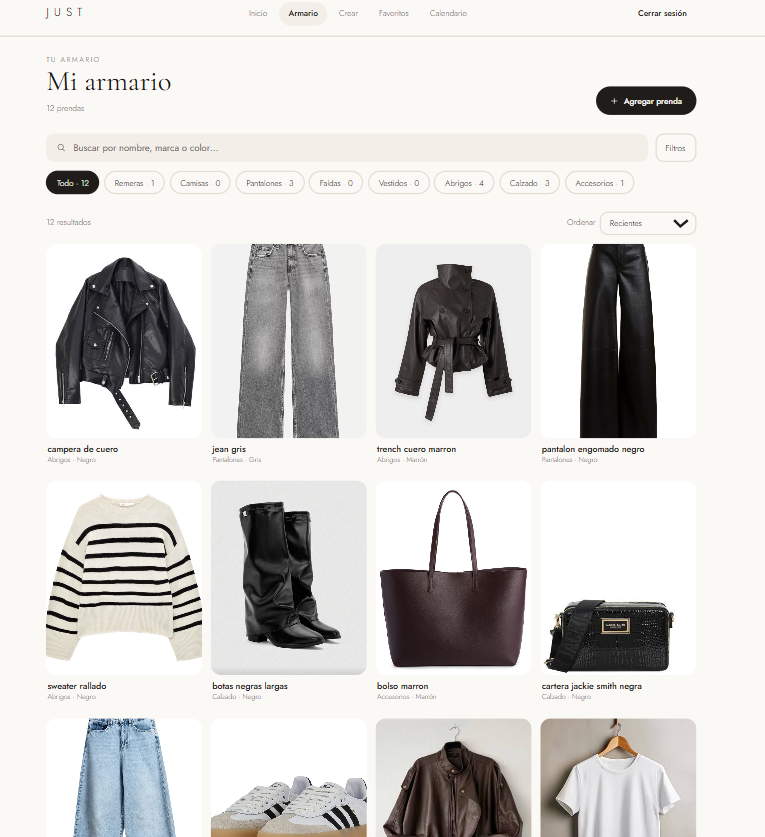
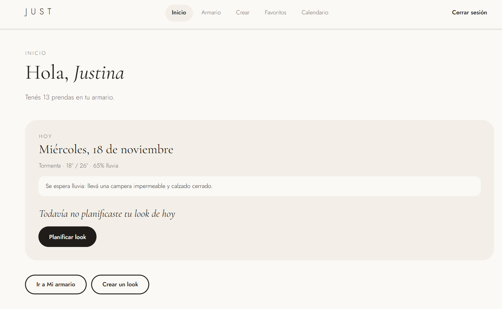
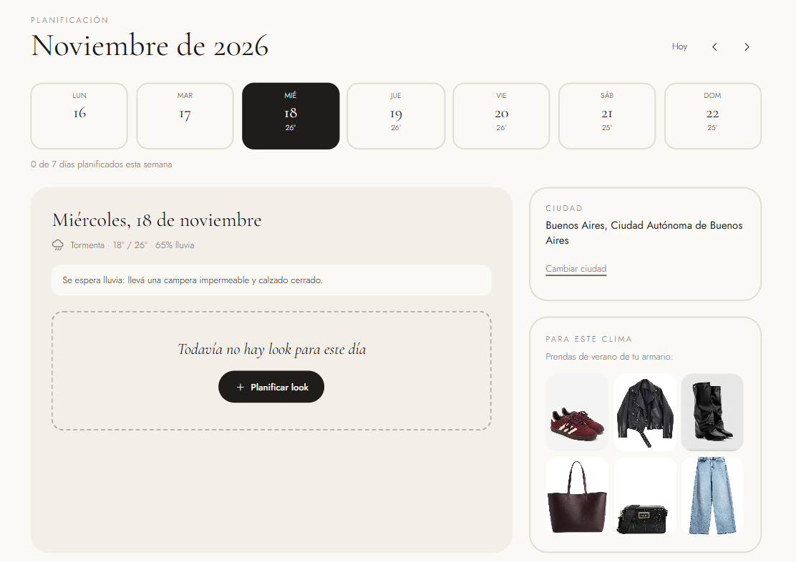
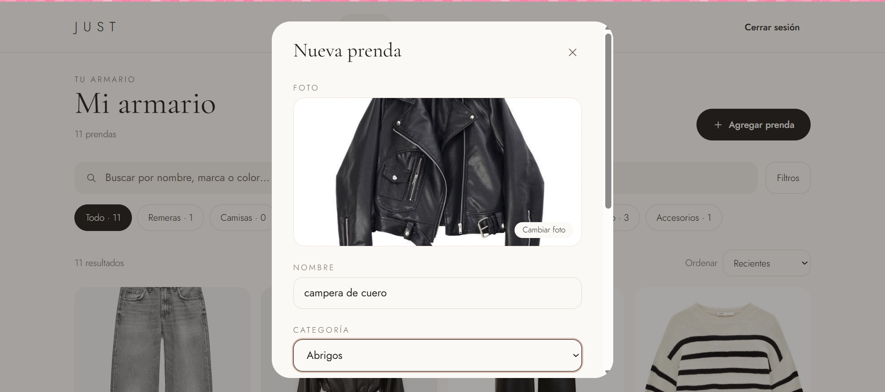
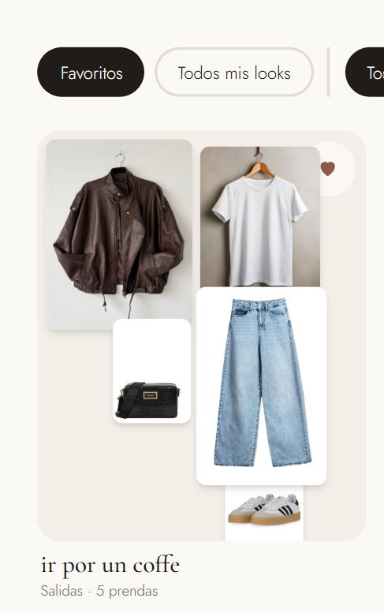

# JUST

**Your wardrobe. Your rules.**

[](https://github.com/JustinaGuerrero/just/actions/workflows/ci.yml)

**Probala online: [just-plum.vercel.app](https://just-plum.vercel.app)**

> El backend está en un plan gratuito que se duerme tras un rato sin uso, así que la primera carga puede tardar alrededor de un minuto.

JUST es un armario digital full stack: subís las fotos de tu ropa, armás looks sobre un lienzo visual y los planificás en un calendario que tiene en cuenta el clima.

Es un proyecto personal que desarrollé de cero, de la base de datos a la interfaz, para practicar y mostrar el desarrollo de una aplicación web completa.



## Funcionalidades

- **Cuenta propia:** registro, inicio y cierre de sesión con cookie `httpOnly` y JWT.
- **Mi armario:** subida de fotos (JPG, PNG o WebP, hasta 5 MB), categoría, estilos y temporadas, y colores a elección: una paleta de 23 o cualquier color propio con su nombre. Búsqueda por nombre, marca o color, filtros, orden y edición, cambio de foto y borrado de cada prenda.
- **Creador de looks:** lienzo visual donde se mueven y escalan las prendas con el puntero, con ocasión y nombre para cada look.
- **Favoritos:** marcá tus looks preferidos y filtralos por ocasión.
- **Calendario:** planificá un look por día, con el pronóstico real de tu ciudad, un consejo de vestimenta y prendas sugeridas de tu armario según la temperatura.
- **Inicio:** resumen del día con el clima y el look que planificaste.
- **Responsive y accesible:** funciona en celular y escritorio, con etiquetas, foco visible y áreas táctiles de 44 px.

| Inicio | Calendario |
| --- | --- |
|  |  |

| Nueva prenda | Look guardado |
| --- | --- |
|  |  |

## Tecnologías

**Frontend** (`client`)
- React 19 + TypeScript + Vite
- Tailwind CSS v4
- React Router
- TanStack Query

**Backend** (`server`)
- Node.js + Express 5 + TypeScript
- Prisma ORM + PostgreSQL 16
- Validación con Zod
- Autenticación con bcrypt y JWT en cookie `httpOnly`
- Subida de imágenes con Multer y Cloudinary

**Infraestructura**
- Frontend en [Vercel](https://vercel.com), que también reenvía `/api` al backend para que la cookie de sesión sea de primera parte.
- Backend en [Render](https://render.com) y base de datos PostgreSQL en [Neon](https://neon.tech).
- CI con GitHub Actions: lint, tests y build del frontend, y chequeo de tipos del backend.

**Servicios externos**
- [Open-Meteo](https://open-meteo.com): pronóstico y búsqueda de ciudades, sin clave de API.
- [Cloudinary](https://cloudinary.com): almacenamiento de las fotos.

## Cómo correrlo en tu computadora

Necesitás Node.js 20 o superior, Docker y una cuenta gratuita de Cloudinary.

```bash
# 1. Clonar el repo
git clone https://github.com/JustinaGuerrero/just.git
cd just

# 2. Levantar la base de datos (PostgreSQL en el puerto 5433)
docker compose up -d

# 3. Backend
cd server
cp .env.example .env      # completá JWT_SECRET (32+ caracteres) y las claves de Cloudinary
npm install
npm run db:generate
npm run db:migrate
npm run dev               # http://localhost:3001

# 4. Frontend (en otra terminal)
cd client
npm install
npm run dev               # http://localhost:5173
```

## Estructura

```
just/
├── client/    # React + Vite
│   └── src/
│       ├── components/   # layout, campos y piezas compartidas
│       ├── features/     # auth, garments, outfits y planner
│       ├── lib/          # api, catálogo, fechas y clima
│       └── pages/        # una pantalla por ruta
├── server/    # Express + Prisma
│   ├── prisma/           # esquema y migraciones
│   └── src/
│       ├── routes/       # auth, garments, outfits y planned
│       ├── middleware/   # autenticación
│       └── lib/          # Prisma y Cloudinary
└── docker-compose.yml    # PostgreSQL local
```

## API

Todas las rutas, salvo las de autenticación, requieren sesión.

| Recurso | Rutas |
| --- | --- |
| Autenticación | `POST /api/auth/register`, `POST /api/auth/login`, `POST /api/auth/logout`, `GET /api/auth/me` |
| Prendas | `GET /api/garments`, `GET /api/garments/counts`, `POST /api/garments`, `PATCH /api/garments/:id`, `DELETE /api/garments/:id` |
| Looks | `GET /api/outfits`, `GET /api/outfits/:id`, `POST /api/outfits`, `PUT /api/outfits/:id`, `PATCH /api/outfits/:id`, `DELETE /api/outfits/:id` |
| Calendario | `GET /api/planned?from=&to=`, `PUT /api/planned/:fecha`, `DELETE /api/planned/:fecha` |

## Decisiones de diseño

- Cada usuario solo puede ver y modificar sus propios datos: todas las consultas filtran por el usuario de la sesión.
- Las posiciones de las prendas en un look se guardan en porcentajes, para que el lienzo se vea igual en cualquier tamaño de pantalla.
- Las fechas del calendario viajan como `YYYY-MM-DD` y se guardan sin hora, para evitar corrimientos por zona horaria.
- El clima se consulta desde el navegador y se cachea 30 minutos, así que el servidor no depende de ningún servicio externo para eso.

## Tests

```bash
cd server && npm test    # API: autenticación, prendas, looks y calendario
cd client && npm test    # fechas, clima y colores
```

- **Backend:** prueban cada ruta de la API (validaciones, sesión, permisos entre usuarios, subida y reemplazo de fotos), con la base de datos y Cloudinary simulados, así que corren en segundos y sin cuentas externas.
- **Frontend:** prueban la lógica de fechas, clima y colores.
- Todo corre automáticamente en cada push con GitHub Actions, junto con el lint, el build y el chequeo de tipos.

---

Hecho por [Justina Guerrero](https://github.com/JustinaGuerrero).
